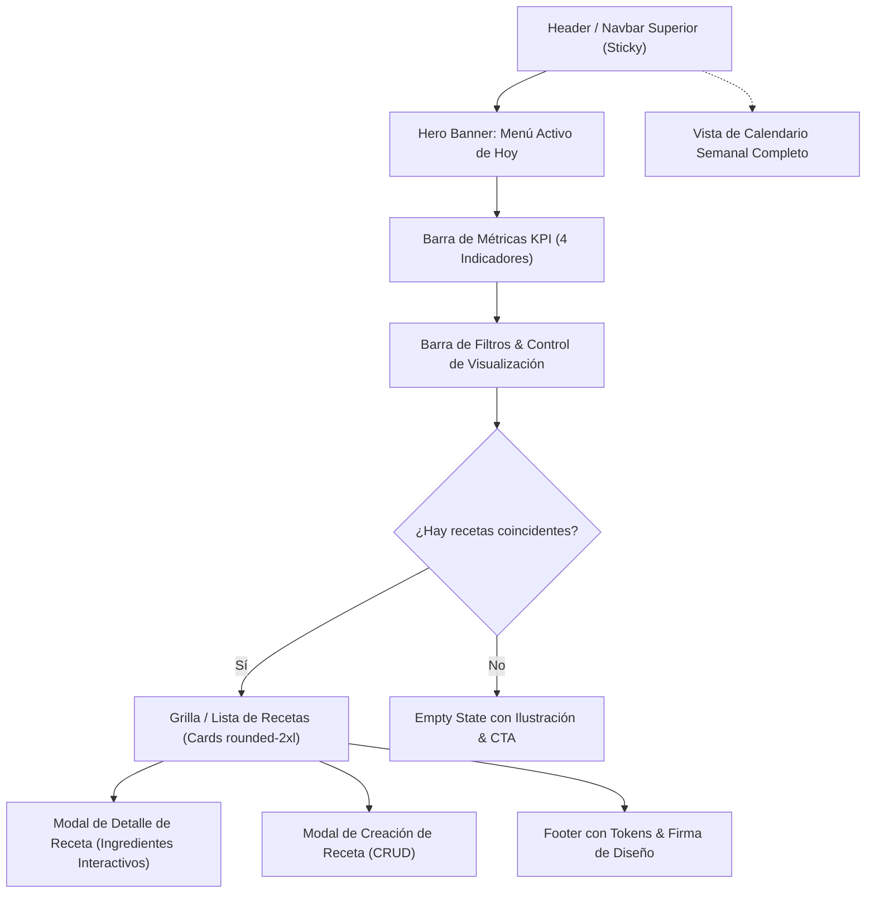

# 🎨 Especificación de Diseño UI/UX: Pantalla Principal (MenuCraft)
**Diseñado por:** Sofía Chen (UI/UX Designer)  
**Proyecto:** `app-menu` (https://github.com/Benja3o3/app-menu)  
**Figma File Key:** `OwIHYtWU6OhW6U6r8GFnvL`  
**Estado:** ✅ Aprobado & Código Implementado (React + TypeScript + Tailwind CSS)

---

## 1. 🌟 Visión del Diseño & Concepto Culinario Retro-Moderno

La pantalla principal de **MenuCraft** fusiona la elegancia de una interfaz oscura moderna (`dark-first`) con sutiles acentos retro pixel art inspirados en la estética gamificada de cocina ("Chef Levels", "Pixel Badges", contornos nítidos y barras de progreso radiantes).

El objetivo es permitir al usuario:
1. **Visualizar de un vistazo su alimentación del día** gracias al banner destacado de Menú Activo.
2. **Explorar y filtrar rápidamente su biblioteca de recetas** mediante píldoras de categorías táctiles e intuitivas.
3. **Alternar entre vistas de cuadrícula visual y lista compacta** para adaptarse a diferentes momentos de uso (planificación relajada vs. consulta rápida en la cocina).
4. **Registrar nuevas recetas e interactuar de forma inmediata** con ingredientes interactivos (modo checklist).

---

## 2. 🎨 Tokens del Sistema de Diseño & Paleta Oficial

| Token de Color | Valor Hex | Rol & Aplicación en la UI |
| :--- | :--- | :--- |
| **Primario** | `#6366f1` (Indigo 500) | Botones principales (`+ Nueva Receta`), bordes activos en hover, gradientes de marca y estados seleccionados. |
| **Fondo Oscuro** | `#090d16` (Deep Navy) | Fondo general de la aplicación con sutil trama de rejilla radial de 24px (`subtle-grid-bg`). |
| **Superficie / Cards** | `#1e293b` (Slate 800) | Tarjetas de recetas, barras de navegación, modales y contenedores de métricas. |
| **Superficie Hover** | `#24334a` (Slate 750) | Elevación al interactuar con tarjetas y elementos clicables. |
| **Texto Principal** | `#f8fafc` (Slate 50) | Encabezados, títulos de recetas y valores numéricos de alto contraste. |
| **Texto Secundario / Muted** | `#94a3b8` (Slate 400) | Descripciones, unidades de medida y metadatos secundarios. |
| **Acento / Éxito** | `#10b981` (Emerald 500) | Indicadores de platos completados, badges de estado óptimo y porcentaje de avance. |
| **Acento Warning / Calórico** | `#f59e0b` (Amber 500) | Indicador de calorías diarias y calificación con estrellas. |
| **Borde / Separadores** | `#334155` (Slate 700) | Delimitadores de componentes con opacidades entre `40%` y `70%`. |

### Tipografía
- **Fuente Principal:** `Inter` (sans-serif), legible, espaciada y moderna.
- **Fuente de Acento Retro:** `Press Start 2P` (monospace / pixel art) para badges de versión, niveles de chef y tags de estado destacados.

---

## 3. 📐 Arquitectura de la Pantalla Principal

---

## 4. 🧩 Especificación de Componentes Clave

### 4.1 Navbar (`Navbar.tsx`)
- **Logo de Marca:** Icono `ChefHat` con degradado `from-[#6366f1] via-indigo-500 to-emerald-400` y badge retro `RETRO v1.0`.
- **Navegación:** Pestañas activas con fondo `#6366f1` y sombra de resplandor (`shadow-indigo-500/30`).
- **Buscador Rápido:** Input oscuro con atajo visual `⌘K` y búsqueda en tiempo real por título, ingredientes o etiquetas.
- **Badge de Avatar de Usuario:** Avatar circular con insignia retro gamificada `★5 (Chef Lvl 5)`.

### 4.2 Hero Banner: Menú Activo (`HeroWeeklyPlanner.tsx`)
- **Propósito:** Mostrar qué se come hoy sin necesidad de buscar.
- **Elementos:**
  - Título del plan semanal (`Menú Balance & Energía - Semana 43`).
  - Tarjetas de 4 momentos del día: Desayuno, Almuerzo, Cena y Snack.
  - Estado de completado con badge esmeralda `#10b981` y hora estimada.
  - Barra de progreso diario con gradiente de `#6366f1` a `#10b981`.
  - Contador de calorías totales consumidas vs planeadas.

### 4.3 Métricas KPI (`MetricCards.tsx`)
- Tarjetas con esquinas `rounded-2xl`, borde `#334155/60`:
  1. **Recetas en Colección:** Número total de recetas + badge de incremento semanal.
  2. **Planes Activos:** Número de planificaciones semanales en curso.
  3. **Platos Favoritos:** Contador de recetas marcadas con corazón.
  4. **Tiempo Promedio:** Promedio en minutos de preparación + cocción.

### 4.4 Filtros y Vistas (`CategoryFilterBar.tsx`)
- **Píldoras de Categorías:** Todas, Desayunos 🥞, Almuerzos 🥗, Cenas 🍲, Snacks 🥑, Postres 🍰.
- **Selector de Ordenamiento:** Más recientes, Mejor valoradas, Menor tiempo, Menos calorías.
- **Toggle Favoritas:** Botón con icono de corazón con micro-interacción.
- **Alternador de Vista:** Botones para vista en cuadrícula (`grid`) y vista horizontal compacta (`list`).

### 4.5 Tarjeta de Receta (`RecipeCard.tsx`)
- **Estructura Visual:**
  - Contenedor con borde redondeado `rounded-2xl` y fondo `#1e293b`.
  - Imagen en formato 16:9 con efecto `scale-105` en hover.
  - Badge retro con recorte pixelado (`pixel-corners`) para la categoría.
  - Botón de corazón flotante con feedback inmediato.
  - Calificación con estrellas en badge flotante translúcido.
  - Ficha de metadatos inferior: Tiempo total, Calorías y Nivel de Dificultad.
  - Botones de acción: "Ver Receta" y acceso rápido para agregar al menú semanal.

### 4.6 Modal de Detalle (`RecipeDetailModal.tsx`)
- Apertura fluida con fondo `backdrop-blur-sm` y animación de entrada.
- Vista a dos columnas:
  - **Ingredientes:** Lista interactiva con casillas de verificación que tachan los elementos ya disponibles en cocina.
  - **Instrucciones:** Pasos numerados con círculos de acento índigo.

### 4.7 Modal de Creación (`CreateRecipeModal.tsx`)
- Formulario modular preparado para el CRUD de recetas (`feat-1792694603190-gg6o`).
- Inclusión dinámica de ingredientes (nombre, cantidad, unidad) y pasos de preparación.

---

## 5. 📱 Responsive & Accesibilidad (A11y)
- **Desktop (>= 1024px):** Disposición de 3 columnas para la cuadrícula, barra de búsqueda completa y métricas en 4 columnas.
- **Tablet (768px - 1023px):** Disposición de 2 columnas, scroll horizontal para píldoras de categorías.
- **Mobile (< 768px):** Menú tipo Drawer desplegable, tarjetas en 1 columna, botones táctiles de 44px de altura mínima.
- **Contraste:** Los textos principales (`#f8fafc`) sobre fondo `#090d16` y `#1e293b` superan un ratio de contraste de 14:1, excediendo la norma WCAG AAA.

---

## 6. 🔗 Sincronización con Figma
- Comentario registrado en el archivo Figma `OwIHYtWU6OhW6U6r8GFnvL` vinculando la implementación de la pantalla principal.
- Tokens y componentes listos para sincronización con variables de diseño en Figma.
